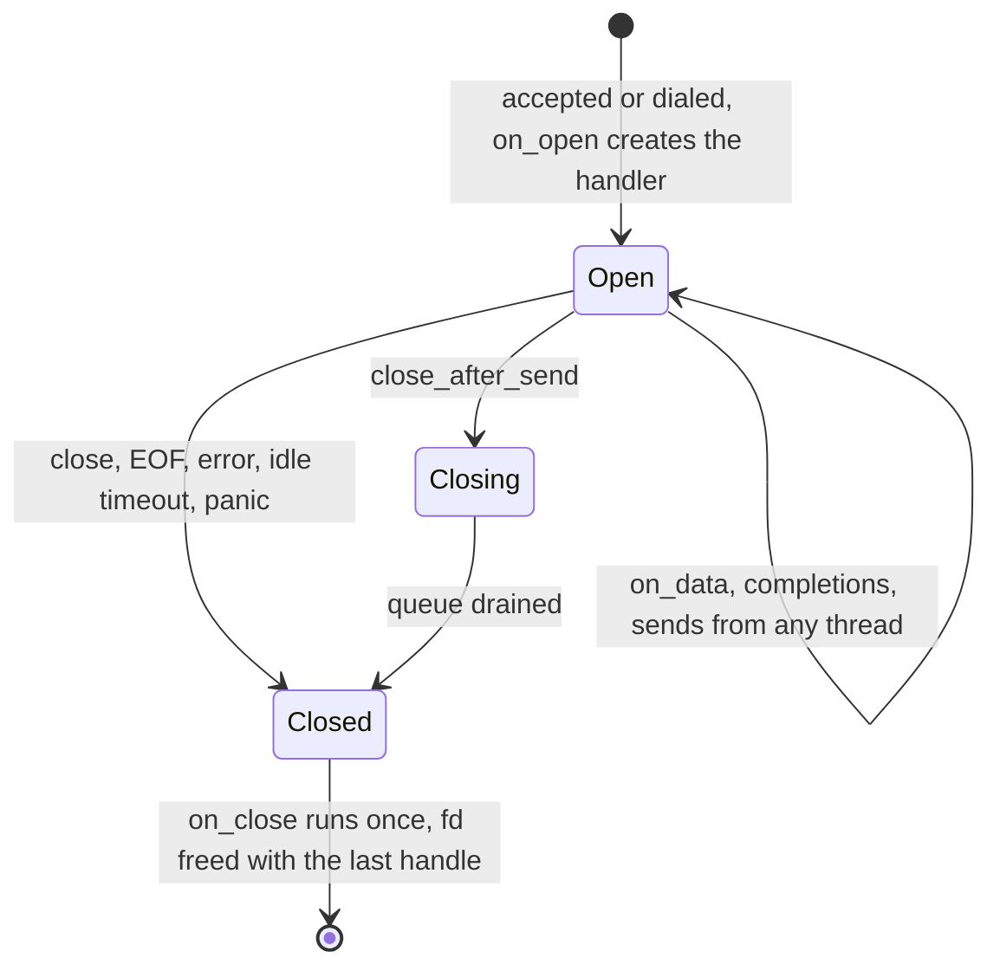

# Lifecycle and shutdown

## A connection's life



- **Open.** `Acceptor::on_open` runs on the owning I/O thread as soon as the connection is
  accepted (or, for `Engine::dial`, connected) and returns the handler. With a transport (TLS),
  the handshake runs from here, and application bytes sent meanwhile are held back until it
  completes.
- **Closing.** After `close_after_send()` further sends fail with `Closed`; the connection closes
  once its queue is written (a TLS transport sends `close_notify` first).
- **Closed.** `on_close` runs exactly once, after every `on_data`. Pending `spawn_blocking`
  completions are dropped. Handles still held elsewhere return `Error::Closed`.

Close reasons and what `on_close` gets:

| Cause | `err` |
|---|---|
| `close()`, or peer EOF after output drained | `None` |
| `Config::idle_timeout` with no inbound data | `Some(Io(TimedOut))` |
| socket error, reset by peer | `Some(Io(..))` |
| a callback panicked | `Some(..)` describing the panic |
| transport (TLS) failure | `Some(..)`; the alert is flushed first |

The idle timeout counts inbound data only, has about a millisecond of resolution and can be
changed at runtime (`Engine::reload`); open connections re-arm their timers immediately.

## Dialing

`Engine::dial(addr, acceptor, on_error)` connects without blocking. When the connection is
established, `acceptor.on_open` runs on an I/O thread exactly as for an accepted connection; if
it fails, `on_error(io::Error)` is called instead. The engine must be started.

```rust,ignore
{{#include ../../../../crates/only/examples/guide-basics.rs:dial}}
```

Wrap the acceptor in `only::tls::Tls::client(..)` to dial TLS. Higher-level clients (HTTP,
HTTP/2, WebSocket, gRPC, arpc) are built on `dial`. `EngineRef` is a late-bound weak handle for
services that are constructed before the engine and need to dial from inside handlers (proxies).

## Graceful shutdown

```rust,ignore
{{#include ../../../../crates/only/examples/guide-basics.rs:shutdown}}
```

`Engine::shutdown()` returns immediately and can be called from any thread (a signal handler
thread, an admin endpoint). Then:

1. Every listener stops accepting.
2. Each acceptor's `on_shutdown` runs for each of its open connections (on their I/O threads).
   The default does nothing; protocol crates use it to finish politely: only-http closes each
   HTTP/1 connection right after its in-flight responses are written, HTTP/2 sends `GOAWAY`
   and lets open streams finish.
   Connections still dialing get `on_error(ConnectionAborted)`.
3. The engine waits for connections to close, up to `Config::shutdown_timeout` (10 s by
   default, reloadable).
4. Whatever is still open is closed forcibly (`on_close` still runs).
5. The I/O threads exit; `wait()` then stops the logical pool and returns.

UDP listeners do not wait for a drain: their peers are closed when shutdown starts.

A typical `main`:

```rust,ignore
let engine = Arc::new(Engine::builder()/* ... */.build()?);
engine.start()?;
let e = engine.clone();
std::thread::spawn(move || {
    wait_for_sigterm(); // your signal handling of choice
    e.shutdown();
});
engine.wait();
```

## Errors at build time

`EngineBuilder::build` returns `io::Error` for: a listener without `.serve(..)`, a bind failure
(address in use, permission), an unsupported combination (`strict` io_uring or eBPF where it is
unavailable, UDP on io_uring with `strict`).
