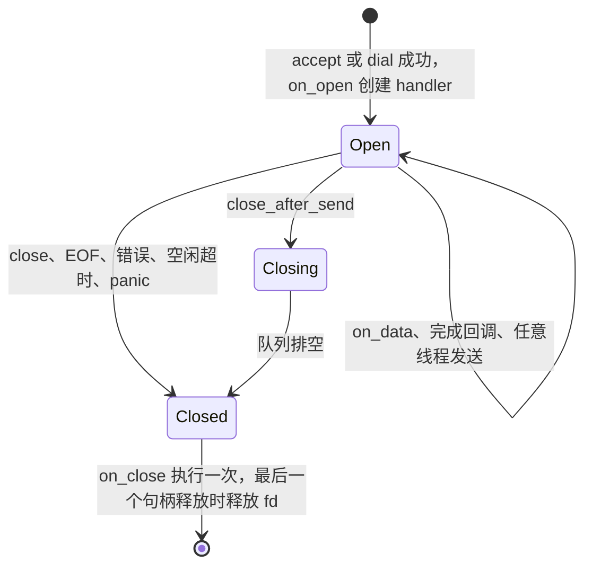

# 生命周期与停机

## 一个连接的一生



- **Open。** 连接被 accept（对 `Engine::dial` 而言是连接建立）后，`Acceptor::on_open` 立即在
  所属 I/O 线程上执行并返回 handler。有 transport（TLS）时，握手从这里开始，期间应用发送的
  数据会被暂存，握手完成后发出。
- **Closing。** `close_after_send()` 之后再发送会返回 `Closed`；队列写完后连接关闭（TLS
  transport 会先发 `close_notify`）。
- **Closed。** `on_close` 恰好执行一次，在所有 `on_data` 之后。尚未执行的 `spawn_blocking`
  完成回调被丢弃。别处仍持有的句柄返回 `Error::Closed`。

关闭原因与 `on_close` 收到的值：

| 原因 | `err` |
|---|---|
| `close()`，或输出排空后对端 EOF | `None` |
| `Config::idle_timeout` 期间没有收到数据 | `Some(Io(TimedOut))` |
| socket 错误、对端重置 | `Some(Io(..))` |
| 回调 panic | `Some(..)`，描述该 panic |
| transport（TLS）失败 | `Some(..)`；先刷出 alert |

空闲超时只计算收到的数据，精度约 1 毫秒，可以在运行时修改（`Engine::reload`）；已打开的
连接会立即重新设置定时器。

## 主动连接（dial）

`Engine::dial(addr, acceptor, on_error)` 以非阻塞方式发起连接。连接建立后，
`acceptor.on_open` 在某个 I/O 线程上执行，与被 accept 的连接完全一样；失败时改为调用
`on_error(io::Error)`。engine 必须已经 start。

```rust,ignore
{{#include ../../../../crates/only/examples/guide-basics.rs:dial}}
```

用 `only::tls::Tls::client(..)` 包装 acceptor 即可发起 TLS 连接。更高层的客户端（HTTP、
HTTP/2、WebSocket、gRPC、arpc）都建立在 `dial` 之上。`EngineRef` 是一个延迟绑定的弱句柄，
供那些在 engine 之前构造、又需要在 handler 里 dial 的服务使用（代理）。

## 优雅停机

```rust,ignore
{{#include ../../../../crates/only/examples/guide-basics.rs:shutdown}}
```

`Engine::shutdown()` 立即返回，可以在任何线程调用（信号处理线程、管理端点）。之后：

1. 所有 listener 停止接收新连接。
2. 对每个仍打开的连接，在其 I/O 线程上调用所属 acceptor 的 `on_shutdown`。默认什么都不做；
   协议 crate 用它礼貌地收尾：only-http 在 HTTP/1 连接的在途响应写完后关闭连接，HTTP/2
   发送 `GOAWAY` 并让已打开的 stream 完成。仍在连接中的 dial 收到
   `on_error(ConnectionAborted)`。
3. engine 等待连接关闭，最多 `Config::shutdown_timeout`（默认 10 s，可热更新）。
4. 仍未关闭的连接被强制关闭（`on_close` 仍会执行）。
5. I/O 线程退出；`wait()` 随后停止逻辑线程池并返回。

UDP listener 不等待排空：停机开始时其 peer 即被关闭。

典型的 `main`：

```rust,ignore
let engine = Arc::new(Engine::builder()/* ... */.build()?);
engine.start()?;
let e = engine.clone();
std::thread::spawn(move || {
    wait_for_sigterm(); // 你选用的信号处理方式
    e.shutdown();
});
engine.wait();
```

## 构建时的错误

`EngineBuilder::build` 在以下情况返回 `io::Error`：listener 没有调用 `.serve(..)`；绑定失败
（地址被占用、权限不足）；不支持的组合（在不支持的环境里使用 `strict` 的 io_uring 或 eBPF，
或对 UDP 使用 `strict` 的 io_uring）。
