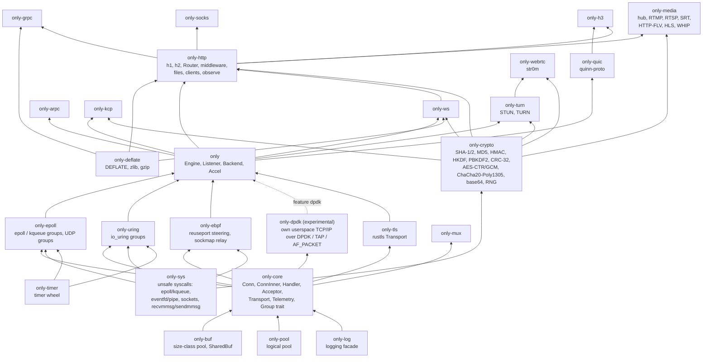
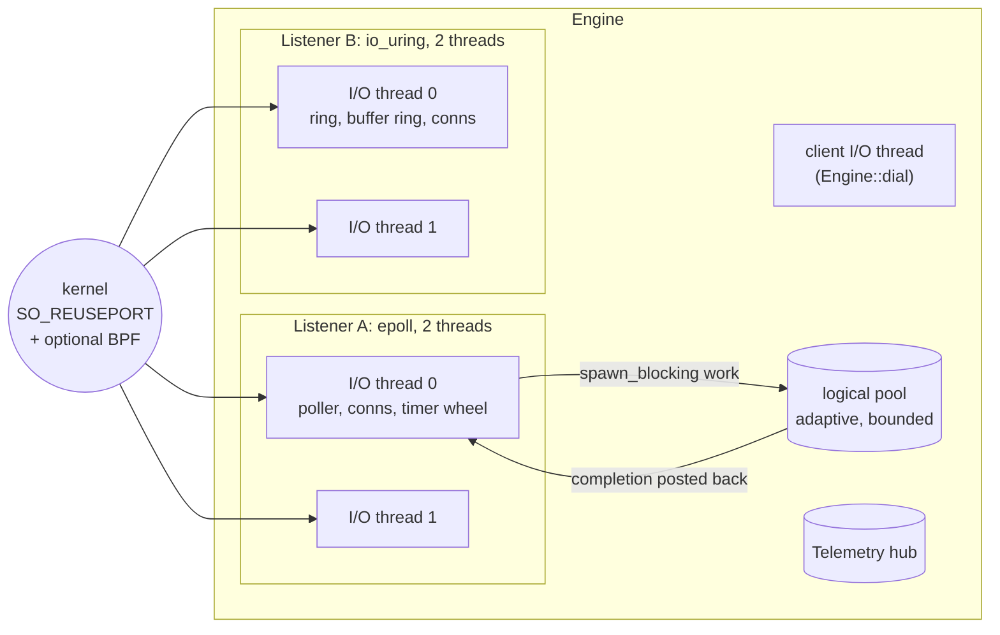
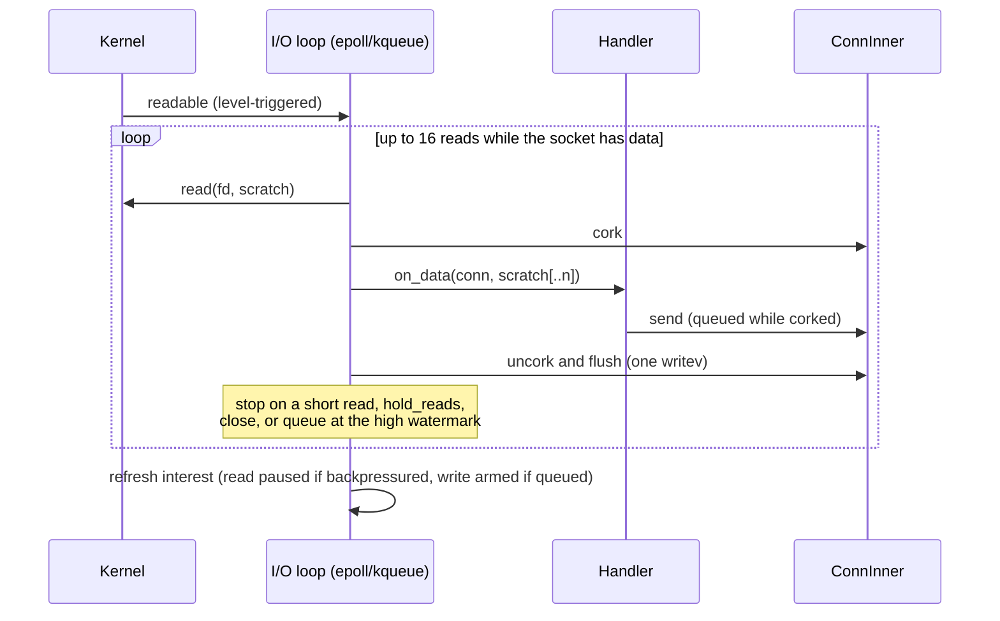
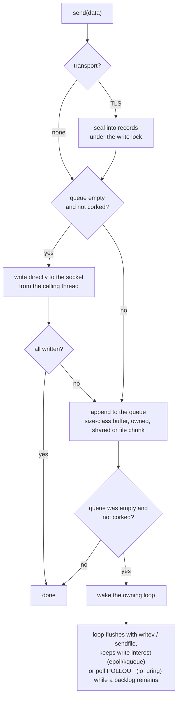
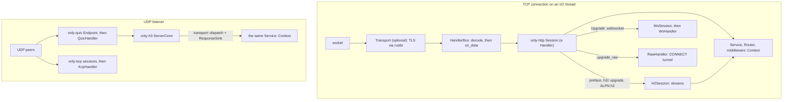
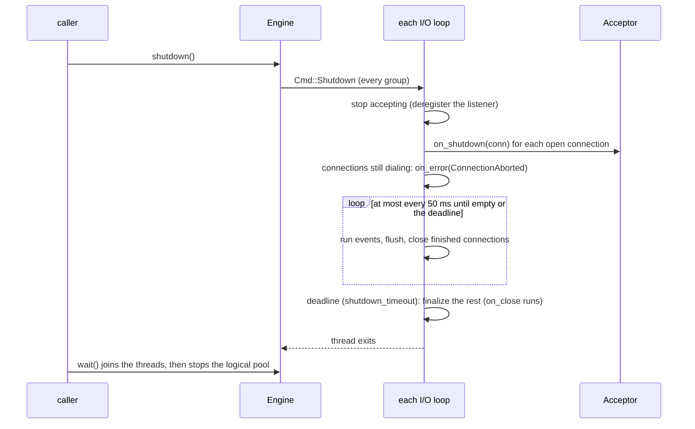

# `only` architecture

English | [简体中文](architecture.zh-CN.md)

This document describes how `only` is built: the crates and their dependencies, the threading and
locking model, what happens on a read and a write on each backend, how memory is managed, how
protocols are layered, and how connections and engines end. The decisions behind it are recorded
in the [ADRs](https://github.com/lesismal/only/tree/main/docs/adr); the user-facing
explanation is in the [book](https://lesismal.github.io/only/en/).

## 1. Crates



- **Dependency direction is one way**: `sys → buf/timer/pool → core → backends → only →
  protocols`. Protocol crates depend on `only-core`'s public traits and the ``only`` facade,
  never on a specific backend.
- **Cryptography is in-house**: `only-crypto` (std only; `unsafe` only for the AES-NI / ARMv8
  AES instructions, with a constant-time portable fallback; the random syscall is in `only-sys`) provides the hashes, MACs, KDFs, CRC-32, constant-time AES-CTR/GCM,
  ChaCha20-Poly1305, base64 and randomness the protocol crates need (KCP crypt, STUN/TURN,
  WebSocket handshakes, SRTP, SRT, RTMP, BitTorrent); TLS, QUIC and DTLS still use rustls /
  quinn-proto / dimpl until the later waves of the DEV-PLAN.
- **`unsafe` is confined** to `only-sys` (which also holds the workspace's own OS bindings, `only_sys::ffi`, in place of the `libc` crate), `only-uring` (its own io_uring binding, ring and buffer-ring memory), `only-ebpf` (raw `bpf(2)`), `only-dpdk` (the DPDK FFI) and `only-crypto`'s AES-instruction module,
  each block with a `SAFETY:` comment. The other crates are `#![forbid(unsafe_code)]` or contain
  no `unsafe` code.
- **Sans-io protocol cores**: HTTP/1 parsing (own zero-copy incremental head parser and chunked
  decoder), HTTP/2 framing and HPACK (own), WebSocket framing and permessage-deflate (DEFLATE from the own `only-deflate`), KCP, QPACK
  and HTTP/3 framing are state machines fed bytes by `only`; TLS is rustls, QUIC is
  quinn-proto and WebRTC is str0m, all driven sans-io (ADR-005) and hidden behind `only`'s own
  types, so they can be upgraded or replaced without breaking the API (docs/api-stability.md).
- The facade `only` re-exports the core API (`Conn`, `Handler`, `Acceptor`, `Config`, ...) and
  composes backend groups into an `Engine`.

## 2. Threading model



- An `Engine` holds one **group** per listener (plus optional client groups for `dial` and
  `dial_udp`). A group is a set of I/O threads; each thread runs one event loop that owns its
  connections, its timer wheel (`only-timer`, millisecond ticks) and its read buffer(s)
  (ADR-001, ADR-004). Groups implement the internal `only_core::Group` trait.
- **Accept distribution**: on Linux every thread binds its own `SO_REUSEPORT` socket and the
  kernel (or a steering program from `only-ebpf`) picks the thread; on macOS the threads share
  one listening socket and race to accept.
- **A connection never migrates.** Its handler is created on its thread and only touched there,
  which is why `Handler: Send` but not `Sync` (ADR-003).
- **The logical pool** (`only-pool`) is engine-wide, adaptive (threads start on demand up to a
  maximum and retire when idle) and bounded (a full queue rejects with `Overloaded`).
  `Conn::spawn_blocking` runs work there and posts the completion back to the owning loop as a
  type-erased task (`LoopLink::post_task`); the loop runs it with `&mut` access to the handler,
  or drops it if the connection is gone.
- **Cross-thread commands** reach a loop through its command queue (a `Mutex<Vec<Cmd>>`) plus a
  waker (eventfd on Linux, a pipe on macOS): `Wake(id)` (flush a queue), `Close(id)`,
  `Task(id, completion)`, `Dial`, `DialUdp`, `Shutdown`, and telemetry requests (connection
  table snapshots, live-setting reloads). A pending-wake flag coalesces wake-ups.

## 3. The connection and its lock (ADR-002)

```text
Conn<H>  (Clone + Send + Sync, PhantomData<fn() -> H>)
   └── Arc<ConnInner>
         ├── id                     process-unique; also guards against fd reuse
         ├── socket                 TcpStream, or a peer on a shared UdpSocket
         ├── state: AtomicU8        OPEN → CLOSING → CLOSED
         ├── read-held / backpressure flags (atomics)
         ├── link: Arc<dyn LoopLink>    wake_conn / close_conn / post_task / pool / stats
         ├── Mutex<WriteState>      send queue, queued bytes, cork, close_after_send,
         │                          on_drain callback, Transport (TLS), datagram flag
         └── Mutex<Ordered>         reserved response slots (ResponseSlot / ResponseStream)
```

- **The write lock guards only the send state** and is never held while user code runs; user
  callbacks run on the loop without it. This rules out lock-ordering deadlocks between
  connections and handlers. The send / close / cork protocols are model-checked with `loom`
  (`RUSTFLAGS="--cfg loom" cargo test -p only-core --lib --release -- loom`).
- **The fd is released** when the connection is closed *and* the last `Arc<ConnInner>` is
  dropped, so a stale handle can never write to a recycled descriptor; operations on a closed
  connection return `Error::Closed`.
- `Conn<H>` is generic only so that `spawn_blocking` completions are typed
  `FnOnce(&mut H, &Conn<H>, R)`; the `PhantomData<fn() -> H>` keeps it `Send + Sync` for any `H`.

## 4. Data flow

### 4.1 Read, epoll / kqueue



- One scratch buffer per thread (`Config::read_buffer`, 64 KiB): idle connections hold no read
  buffer, and `on_data` borrows the scratch for the duration of the call.
- Reading stops early when the handler paused reads, closed the connection, or let its queue
  reach the high watermark: backpressure takes effect within the same event.
- EOF from the peer turns into `close_after_send`: what is owed is written, then the connection
  closes and `on_close(None)` runs.

### 4.2 Read, io_uring

- Each thread owns a ring (cooperative task-run, deferred task-run and single-issuer where the
  kernel allows it) and a **provided-buffer ring** of 1024 buffers of `min(read_buffer, 16 KiB)`
  bytes.
- Each listening socket has one **multishot accept** in flight; each connection has one
  **multishot recv** selecting buffers from the ring, so idle connections hold no buffer.
- A completion carries the buffer id: `on_data` borrows that buffer, and when the callback
  returns the buffer goes back to the ring with a memory write (no syscall, no new submission).
  A first version re-submitted `PROVIDE_BUFFERS` per chunk and reached only ~60% of epoll; the
  buffer ring removed that gap.
- `hold_reads` and backpressure cancel the multishot recv and re-arm it on resume.
- Wake-ups from other threads arrive as an eventfd read completion.

### 4.3 Write, all backends



- The write path is shared by all backends and lives in `ConnInner`: `send` from any thread
  tries a direct `write`; only the remainder is queued, and the owning loop flushes it when the
  socket becomes writable (epoll/kqueue write interest; on io_uring a one-shot
  `poll(POLLOUT)`).
- Inside callbacks the connection is corked, so everything sent leaves in one `writev` when the
  callback returns.
- Chunks are owned bytes (from `only-buf` size classes, appended to when there is room),
  `SharedBuf` broadcasts, file ranges (`sendfile(2)`, never copied, not counted against
  `max_queued_bytes`), or segmented UDP buffers.
- Limits: reads pause at `write_high_watermark` and resume at a quarter of it;
  `max_queued_bytes` makes `send` fail with `Overloaded`. `on_drain` callbacks fire when the
  queue empties.

### 4.4 UDP

- UDP listeners always use the readiness backend. On Linux each thread has its own
  `SO_REUSEPORT` socket (a peer hashes to one thread); elsewhere one thread serves the listener.
- Each new peer address becomes a `ConnInner` over the shared socket, with the normal `Handler`;
  a per-listener peer table, idle eviction (`udp_idle_timeout`) and an optional cap
  (`udp_max_peers`).
- Receives use `recvmmsg` (optionally with GRO, split back into datagrams). Replies produced
  while handling a receive batch are collected per socket and sent with `sendmmsg` across peers;
  equal-size runs to one peer become one GSO message (`UDP_SEGMENT`, probed once, disabled for
  good on `EIO`/`EINVAL`).
- `dial_udp` creates a `connect`ed socket per dialed connection, so ICMP errors are reported to
  it (`ConnectionRefused` closes it).
- QUIC and KCP sit on top of this: their acceptors receive datagrams through `on_data`, run their
  own sans-io state machines and send through `Conn::send` / `send_segments`; a shared timer
  thread per crate drives retransmission and pacing deadlines.

## 5. Memory and buffers

| Buffer | Owner | Size |
|---|---|---|
| epoll/kqueue read scratch | one per I/O thread | `read_buffer` (64 KiB) |
| io_uring provided buffers | one ring per I/O thread | 1024 × `min(read_buffer, 16 KiB)` |
| send queue chunks | per connection, only while something is queued | `only-buf` size classes: 512 B, 4, 16, 64, 256 KiB |
| broadcast frames | shared (`SharedBuf` = `Arc<[u8]>`) | encoded once |
| protocol buffers (HTTP head, WebSocket frames, HTTP/2 frames) | per connection state machine | grow with the message, bounded by protocol limits |

- `only-buf` keeps a small **thread-local** cache of `Vec<u8>` per size class, so taking and
  returning a queue buffer takes no lock. Buffers freed on another thread join that thread's
  (bounded) cache.
- Received data is borrowed, never copied by `only` before your callback. Keeping it requires an
  explicit copy, which keeps every backend zero-copy on the read side (ADR-004).
- Memory per connection is bounded by `max_queued_bytes` for queues and by protocol limits
  (`max_header_bytes`, `max_body_bytes`, `max_message_bytes`, HTTP/2 windows) for parsers.

## 6. Protocol layering



- **`Transport` (TLS).** `Acceptor::transport()` returns an optional `only_core::Transport`
  installed under the connection before `on_open`. Bytes read are passed through
  `Transport::recv` (producing plaintext and possibly handshake bytes to send) before the
  handler sees them; everything sent goes through `Transport::seal` under the write lock, in
  wire order. Application bytes sent during the handshake are held back by the transport and
  emitted when it completes. `close_after_send` appends `Transport::shutdown` output
  (`close_notify`). `only-tls`'s `Tls<A>` is an acceptor wrapper that supplies a rustls
  transport, so any acceptor (HTTP, arpc, raw handlers) gains TLS without knowing about it.
- **HTTP versions share `Context`.** The `only-http` `Session` handler parses HTTP/1 and switches
  to an `H2Session` on the client preface, an `h2c` upgrade or ALPN `h2`. Both build a `Context`
  whose responder is either an ordered `ResponseSlot` (HTTP/1, so pipelined responses stay in
  order even when detached) or an HTTP/2 stream.
- **Transport hook for HTTP/3.** `only_http::transport` lets a transport outside the crate serve
  a `Service`: it parses a request and calls `dispatch(service, request, sink)`, where the sink
  implements `ResponseSink` (`send`, `start_stream` returning a `BodySink`). only-h3 implements
  those on QUIC streams, so routers, middleware, `detach` and `stream_response` behave the same
  on HTTP/3.
- **Upgrades.** `Context::upgrade_websocket` answers 101 and replaces the HTTP state machine with
  a `WsSession` on the same connection; `Context::upgrade_raw` hands the raw byte stream to a
  `RawHandler` (the HTTP CONNECT proxy). The WebSocket session keeps the type-erased
  `ConnInner`, so `WsSender` outlives the HTTP handler type.
- **Multiplexing.** `only-mux` is a type-erased acceptor (`DynAcceptor`) that buffers the first
  bytes, picks a route, then creates the chosen acceptor's handler and replays the bytes to it;
  `spawn_blocking` completions and `on_shutdown` are forwarded to the chosen acceptor.

## 7. Lifecycle and shutdown



- `build` binds every listener (so bind errors surface early) but starts nothing; `start`
  spawns the loops; `run` = `start` + `wait`.
- Connection close is a three-state machine on an atomic (`OPEN → CLOSING → CLOSED`):
  `close_after_send` moves to CLOSING and the loop finalizes once the queue is empty; `close`,
  errors, EOF after the drain, the idle timeout and panics finalize directly. `on_close` runs
  exactly once on the owning thread; pending completions for the connection are dropped.
- The pool is stopped only after the I/O threads exit, because completions need a loop to run
  on.

## 8. Error handling

- **Connection operations** return `only_core::Result<T>` with `Error::Closed` (the operation had
  no effect), `Error::Overloaded` (a bound was hit; the caller decides) or `Error::Io` (an OS
  error; the connection is being closed). A failing write from a non-loop thread schedules the
  close on the owning loop and returns `Closed`.
- **Panics** in handler callbacks are caught on the I/O thread (`catch_unwind`): the connection is
  closed with an error and the thread keeps serving others. Panics in pool jobs are caught by the
  pool, counted, and the completion is skipped.
- **Transport errors** (bad TLS records, failed handshakes) flush the transport's alert, close the
  connection and are counted separately (handshake vs. later).
- **Build-time errors** are `io::Error`: bind failures, missing acceptors, unsupported strict
  combinations (`ErrorKind::Unsupported`).
- **Degradation over failure** for optional accelerations: io_uring falls back to epoll and BPF
  steering to kernel hashing unless `strict`, and the fallback is logged and reported
  (`Engine::accel_status`).
- **Nothing is lost silently**: when no `log` backend is installed, errors and slow-callback
  warnings go to stderr.

## 9. Observability plumbing

Each loop owns a cache-line aligned `LoopStats` (relaxed atomic counters) registered with the
engine's `Telemetry` hub together with a way to post it commands. Metrics snapshots sum the
counters on demand; the connection table is gathered by asking each loop for a snapshot (with a
timeout); slow callbacks are timed around every callback while a threshold is set and kept in a
ring of 256 records. Live settings (`Live`) are atomics read on each use, which is what makes
`Engine::reload` free on the hot path. only-http's `observe` module renders all of this as
Prometheus text and JSON debug views.

## 10. How the architecture is tested

- `loom` models of the send / close / cork protocols (5 models, run in CI).
- The engine, offload and stress suites run on epoll and on io_uring (`ONLY_TEST_BACKEND=uring`).
- 5,000 simultaneous connections and connect/close cycles with fd-leak checks.
- Interop: h2spec, Autobahn (server and client), grpc-go, quic-go, kcp-go, fib.
- eBPF programs tested privileged (eBPF tier, relay) and unprivileged (classic BPF, fallback).
