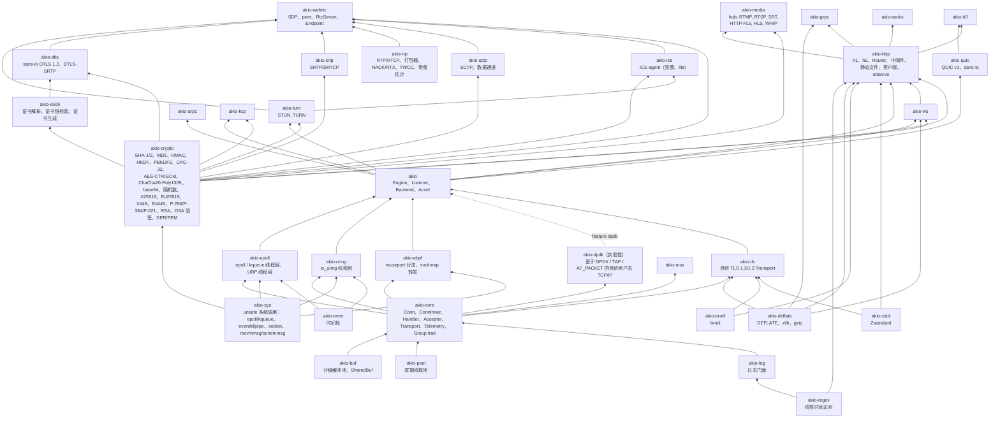
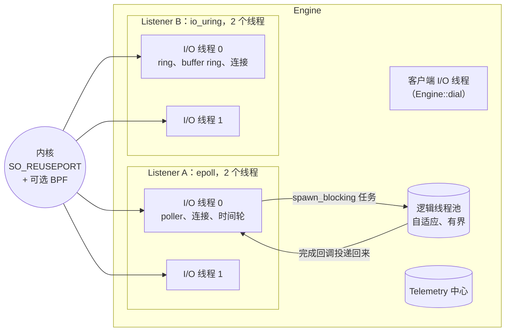
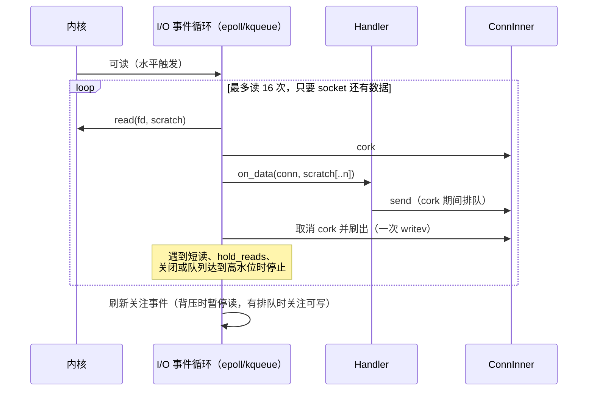
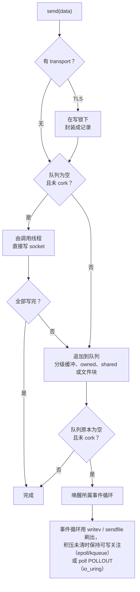
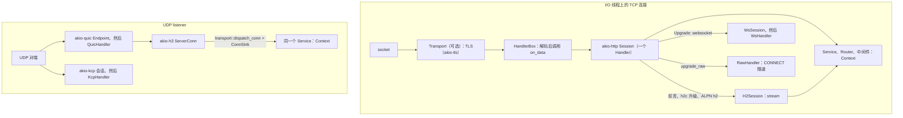
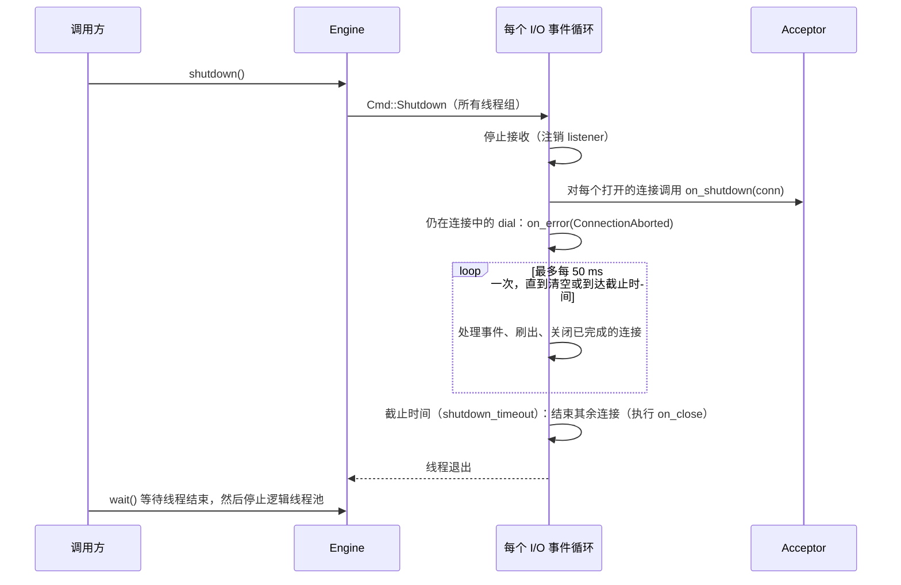

# akio 架构

[English](architecture.md) | 简体中文

本文描述 akio 是如何构建的：各个 crate 及其依赖关系、线程与加锁模型、在每种后端上一次读和
一次写的过程、内存如何管理、协议如何分层，以及连接和 engine 如何结束。背后的决策记录在
[ADR](https://github.com/lesismal/akio/tree/main/docs/adr) 中；面向使用者的说明见
[指南](https://lesismal.github.io/akio/zh-CN/)。

## 1. crate



- **依赖方向是单向的**：`sys → buf/timer/pool → core → 后端 → akio → 协议`。协议 crate 依赖
  `akio-core` 的公开 trait 和 `akio` facade，从不依赖具体后端。
- **密码学自研**：`akio-crypto`（只依赖 std；`unsafe` 只用于 AES-NI / ARMv8 AES 指令，并有常数时间的可移植回退；
  随机数系统调用在 `akio-sys` 中）提供协议
  crate 需要的哈希、MAC、KDF、CRC-32、常数时间 AES-CTR/GCM、ChaCha20-Poly1305、base64 与随机数
  （KCP 加密、STUN/TURN、WebSocket 握手、SRTP、SRT、RTMP、BitTorrent），以及 `akio-x509`（证书解析、
  证书链校验、证书生成）所依赖的公钥算法与密钥格式（X25519、Ed25519、X448、Ed448、P-256/P-384/P-521 的 ECDH/ECDSA、
  RSA PKCS#1/PSS、DSA 验签、DER/PEM、PKCS#8）。`akio-tls` 中的 TLS 1.2/1.3 已运行在这两个 crate 之上（第 C 波）；
  `akio-quic` 中的 QUIC 运行在 `akio-tls` 不经记录层的 TLS 1.3 内核（`akio_tls::quic`）与
  `akio-crypto` 之上（第 D 波）；WebRTC 中的 DTLS 在第 D 波的 WebRTC 部分之前仍使用 dimpl，之后也会
  迁移过来。
  `akio-x509`）是 sans-io 的 DTLS 1.2 客户端/服务端，支持 DTLS-SRTP（`use_srtp`、RFC 5705 导出器）
  以及按指纹固定的自签名证书，驱动方式与 `akio-quic` 驱动其状态机相同（`handle_datagram` /
  `poll_transmit` / `poll_event` / `poll_timeout` / `handle_timeout`，没有线程也没有时钟）。第 D 波的
  WebRTC 协议栈（第 D 波）已采用它；其余各层也是同样形态的 sans-io crate：`akio-ice`（ICE agent，
  基于 `akio-turn` 的 STUN 编解码）、`akio-srtp`、`akio-rtp`（RTP/RTCP、载荷格式、NACK/RTX、TWCC
  与带宽估计）和 `akio-sctp`（SCTP 与 DCEP 数据通道），均为 `#![forbid(unsafe_code)]`。
  `akio-webrtc` 负责 SDP offer/answer，并由 I/O 线程与一个定时器线程驱动每个 peer 的 sans-io
  `Rtc`；它没有第三方依赖。
- **`unsafe` 被限制在** `akio-sys`（其中也包含替代 `libc` crate 的工作区自有操作系统绑定 `akio_sys::ffi`）、`akio-uring`（自研 io_uring 绑定、ring 与 buffer ring 内存）、`akio-ebpf`
  （原始 `bpf(2)`）、`akio-dpdk`（DPDK FFI）和 `akio-crypto` 的 AES 指令模块中，每个 unsafe 块都有 `SAFETY:` 注释。其他 crate 要么是
  `#![forbid(unsafe_code)]`，要么不包含 `unsafe` 代码。
- **sans-io 协议核心**：HTTP/1 解析（零拷贝增量头部解析器与 chunked 解码器均为自研）、HTTP/2 分帧与
  HPACK（自研）、WebSocket 分帧与 permessage-deflate（DEFLATE 来自自研的 `akio-deflate`）、KCP、QPACK 与 HTTP/3 分帧，都是
  由 akio 喂入字节的状态机，TLS 也是（`akio-tls` 自研的记录层与 TLS 1.3 / 1.2 握手状态机），QUIC 也是
  （`akio-quic` 自研的数据包、帧、流、丢包恢复与按连接 ID 路由的 endpoint：数据报进、数据报出，时间由
  外部传入），WebRTC 协议栈也是（ADR-005），都隐藏在 akio 自己的类型之后
  （docs/api-stability.zh-CN.md）。
- facade `akio` 重新导出核心 API（`Conn`、`Handler`、`Acceptor`、`Config` 等），并把后端线程组
  组合成 `Engine`。

## 2. 线程模型



- `Engine` 为每个 listener 持有一个**线程组**（另外还有用于 `dial` 和 `dial_udp` 的可选客户端
  线程组）。线程组是一组 I/O 线程；每个线程运行一个事件循环，拥有自己的连接、时间轮
  （`akio-timer`，毫秒刻度）和读缓冲区（ADR-001、ADR-004）。线程组实现内部的
  `akio_core::Group` trait。
- **连接分发**：Linux 上每个线程绑定自己的 `SO_REUSEPORT` socket，由内核（或 `akio-ebpf` 的
  分流程序）选择线程；macOS 上各线程共享一个监听 socket 并竞争 accept。
- **连接从不迁移。** 它的 handler 在它的线程上创建，也只在那里被访问，所以
  `Handler: Send` 但不需要 `Sync`（ADR-003）。
- **逻辑线程池**（`akio-pool`）全 engine 共享、自适应（按需启动线程直到上限，空闲后退出）且
  有界（队列满时以 `Overloaded` 拒绝）。`Conn::spawn_blocking` 在其中执行任务，再把完成回调
  作为类型擦除的任务投递回所属事件循环（`LoopLink::post_task`）；事件循环以对 handler 的 `&mut`
  访问执行它，连接已不存在时则丢弃它。
- **跨线程命令** 通过事件循环的命令队列（一个 `Mutex<Vec<Cmd>>`）加一个唤醒器（Linux 上为
  eventfd，macOS 上为 pipe）送达：`Wake(id)`（刷出队列）、`Close(id)`、`Task(id, completion)`、
  `Dial`、`DialUdp`、`Shutdown`，以及遥测请求（连接表快照、实时设置热更新）。一个"唤醒待处理"
  标志用于合并唤醒。

## 3. 连接及其锁（ADR-002）

```text
Conn<H>  (Clone + Send + Sync, PhantomData<fn() -> H>)
   └── Arc<ConnInner>
         ├── id                     进程内唯一；同时防止 fd 复用
         ├── socket                 TcpStream，或共享 UdpSocket 上的一个对端
         ├── state: AtomicU8        OPEN → CLOSING → CLOSED
         ├── 暂停读 / 背压标志（原子量）
         ├── link: Arc<dyn LoopLink>    wake_conn / close_conn / post_task / pool / stats
         ├── Mutex<WriteState>      发送队列、排队字节数、cork、close_after_send、
         │                          on_drain 回调、Transport（TLS）、数据报标志
         └── Mutex<Ordered>         预留的响应槽位（ResponseSlot / ResponseStream）
```

- **写锁只保护发送状态**，用户代码运行时从不持有它；用户回调在事件循环上执行，不持有这把锁。
  这排除了连接与 handler 之间因锁顺序导致的死锁。发送 / 关闭 / cork 协议用 `loom` 做了模型检查
  （`RUSTFLAGS="--cfg loom" cargo test -p akio-core --lib --release -- loom`）。
- **fd 在连接关闭*并且*最后一个 `Arc<ConnInner>` 被 drop 时才释放**，因此过期的句柄永远不会写到
  被复用的描述符上；对已关闭连接的操作返回 `Error::Closed`。
- `Conn<H>` 带泛型只是为了让 `spawn_blocking` 的完成回调具有 `FnOnce(&mut H, &Conn<H>, R)`
  类型；`PhantomData<fn() -> H>` 使它对任意 `H` 都是 `Send + Sync`。

## 4. 数据流

### 4.1 读：epoll / kqueue



- 每个线程一个临时缓冲区（`Config::read_buffer`，64 KiB）：空闲连接不占读缓冲，`on_data` 在
  调用期间借用这个缓冲区。
- handler 暂停读、关闭连接或让队列达到高水位时，读取会提前停止：背压在同一个事件内生效。
- 对端 EOF 会变成 `close_after_send`：先写完欠下的数据，然后关闭连接并执行 `on_close(None)`。

### 4.2 读：io_uring

- 每个线程拥有一个 ring（内核支持时启用 cooperative task-run、deferred task-run 和
  single-issuer）以及一个 **provided-buffer ring**，含 1024 个 `min(read_buffer, 16 KiB)` 字节
  的缓冲区。
- 每个监听 socket 有一个 **multishot accept** 在途；每个连接有一个从 ring 中选择缓冲区的
  **multishot recv**，所以空闲连接不占缓冲区。
- 完成事件携带缓冲区 id：`on_data` 借用该缓冲区，回调返回后通过一次内存写把它归还给 ring
  （没有系统调用，也没有新的提交）。第一个版本每块数据都重新提交 `PROVIDE_BUFFERS`，只达到
  epoll 的约 60%；改用 buffer ring 后差距消失。
- `hold_reads` 和背压会取消 multishot recv，恢复时重新提交。
- 来自其他线程的唤醒以 eventfd 读完成事件的形式到达。

### 4.3 写：所有后端



- 写路径由所有后端共享，实现在 `ConnInner` 中：任何线程上的 `send` 都先尝试直接 `write`；
  只有剩余部分排队，由所属事件循环在 socket 可写时刷出（epoll/kqueue 用可写关注；io_uring 用
  一次性的 `poll(POLLOUT)`）。
- 回调内部连接处于 cork 状态，所以发送的所有数据在回调返回时合并为一次 `writev`。
- 队列块可以是 owned 字节（来自 `akio-buf` 的分级缓冲，有空间时追加）、`SharedBuf` 广播、
  文件区间（`sendfile(2)`，从不复制，不计入 `max_queued_bytes`），或分段的 UDP 缓冲区。
- 上限：达到 `write_high_watermark` 时暂停读，降到四分之一时恢复；超过 `max_queued_bytes` 时
  `send` 返回 `Overloaded`。队列清空时触发 `on_drain` 回调。

### 4.4 UDP

- UDP listener 总是使用就绪通知后端。Linux 上每个线程有自己的 `SO_REUSEPORT` socket（一个对端
  哈希到一个线程）；其他系统上由一个线程服务该 listener。
- 每个新的对端地址成为共享 socket 上的一个 `ConnInner`，使用普通的 `Handler`；每个 listener
  有一张对端表、空闲淘汰（`udp_idle_timeout`）和可选的上限（`udp_max_peers`）。
- 接收使用 `recvmmsg`（内核支持时默认开启 GRO，按 `UDP_GRO` 分段大小再拆回单个数据报）。一批接收
  涉及的每个连接在最后一个数据报之后收到一次内部的 `on_batch_end`（akio-quic 在这里生成 ACK 并
  发送）。处理一批接收时产生的回复按 socket 收集，
  用 `sendmmsg` 跨对端发出；发往同一对端的等长连续数据报合并为一条 GSO 消息（`UDP_SEGMENT`，
  只探测一次，遇到 `EIO`/`EINVAL` 永久关闭）。
- 接收槽位是池化的 slab（`akio_buf::slab`，ADR-024）：要求以所有权方式接收数据报的 handler
  （隐藏的 `Handler::OWNED_DATA`，akio-quic）会以可写区间的形式拿到每个数据报——它是从所在 slab 上
  切下来的（`on_data_owned`），可以保留；akio-quic 就地解密，因此 1-RTT 数据报从内核到应用之间不再
  复制。其它 handler 原地读取。对端表用 `akio_core::hash` 的带密钥折叠乘法对地址做哈希。
- `dial_udp` 为每个 dial 出的连接创建一个 `connect` 过的 socket，因此 ICMP 错误会报告给它
  （`ConnectionRefused` 会关闭它）。
- QUIC 和 KCP 建立在此之上：它们的 acceptor 通过 `on_data` 接收数据报，运行各自的 sans-io 状态
  机，并通过 `Conn::send` / `send_segments` 发送；每个 crate 有一个共享的定时器线程驱动重传和
  节奏控制的截止时间。

## 5. 内存与缓冲区

| 缓冲区 | 所有者 | 大小 |
|---|---|---|
| epoll/kqueue 读临时缓冲区 | 每个 I/O 线程一个 | `read_buffer`（64 KiB） |
| io_uring provided buffer | 每个 I/O 线程一个 ring | 1024 × `min(read_buffer, 16 KiB)` |
| 发送队列块 | 每连接，只在有数据排队时存在 | `akio-buf` 分级：512 B、4、16、64、256 KiB |
| 广播帧 | 共享（`SharedBuf` = `Arc<[u8]>`） | 只编码一次 |
| 协议缓冲区（HTTP 请求头、WebSocket 帧、HTTP/2 帧） | 每连接的状态机 | 随消息增长，受协议上限约束 |

- `akio-buf` 为每个大小级别维护一个小的**线程本地**`Vec<u8>` 缓存，因此取用和归还队列缓冲区
  都不加锁。在其他线程释放的缓冲区进入那个线程的（有上限的）缓存。
- 收到的数据以借用方式交给回调，akio 在回调之前从不复制。需要保留时由你显式复制，这让所有
  后端在读路径上都保持零拷贝（ADR-004）。
- 每连接内存由 `max_queued_bytes`（队列）和协议上限（`max_header_bytes`、`max_body_bytes`、
  `max_message_bytes`、HTTP/2 窗口；解析器）约束。

## 6. 协议分层



- **`Transport`（TLS）。** `Acceptor::transport()` 返回一个可选的 `akio_core::Transport`，在
  `on_open` 之前安装到连接之下。读到的字节先经过 `Transport::recv`（产生明文，可能还有需要发送
  的握手字节），再交给 handler；发送的一切都在写锁下按线路顺序经过 `Transport::seal`。握手期间
  应用发送的字节由 transport 暂存，握手完成后发出。`close_after_send` 会追加
  `Transport::shutdown` 的输出（`close_notify`）。`akio-tls` 的 `Tls<A>` 是一个提供自研 TLS
  transport（记录层加 TLS 1.3 / 1.2 状态机，sans-io）的 acceptor 包装器，因此任意 acceptor（HTTP、arpc、原始 handler）都能在毫不知情的
  情况下获得 TLS。
- **HTTP 各版本共享 `Context`。** akio-http 的 `Session` handler 解析 HTTP/1，遇到客户端前言、
  `h2c` 升级或 ALPN `h2` 时切换到 `H2Session`。两者构建的 `Context` 的响应端要么是有序的
  `ResponseSlot`（HTTP/1，因此即使 detach，流水线响应也保持顺序），要么是 HTTP/2 stream。
- **HTTP/3 的 transport 钩子。** `akio_http::transport` 让 crate 之外的 transport 也能提供
  `Service`：它解析出请求后调用 `dispatch_conn(service, request, sink, tag)`，sink 是连接的
  `ConnSink`（`send`，以及返回 `BodySink` 的 `start_stream`，都会带上请求的 tag），经瘦句柄
  `SharedSink` 共享；target 用 `request_target`、头部用 `request_headers` 构造，复用按线程保留的已完成请求的存储（ADR-025、ADR-081）。akio-h3 在 QUIC stream 上实现了这些，所以 router、
  中间件、`detach` 和 `stream_response` 在 HTTP/3 上表现一致。旧的按请求 `ResponseSink`
  （`dispatch`、`start`）已弃用。
- **升级。** `Context::upgrade_websocket` 应答 101，并在同一连接上用 `WsSession` 替换 HTTP 状态
  机；`Context::upgrade_raw` 把原始字节流交给 `RawHandler`（HTTP CONNECT 代理）。WebSocket 会话
  保留类型擦除的 `ConnInner`，所以 `WsSender` 的生命周期可以超过 HTTP handler 类型。
- **复用。** `akio-mux` 是一个类型擦除的 acceptor（`DynAcceptor`），它缓存最初的字节、选择
  路由，然后创建所选 acceptor 的 handler 并把字节重放给它；`spawn_blocking` 的完成回调和
  `on_shutdown` 会转发给所选的 acceptor。

## 7. 生命周期与停机



- `build` 绑定所有 listener（让绑定错误尽早暴露）但不启动任何东西；`start` 启动事件循环；
  `run` = `start` + `wait`。
- 连接关闭是基于一个原子量的三态机（`OPEN → CLOSING → CLOSED`）：`close_after_send` 进入
  CLOSING，队列清空后由事件循环结束；`close`、错误、排空后的 EOF、空闲超时和 panic 直接结束。
  `on_close` 在所属线程上恰好执行一次；该连接尚未执行的完成回调被丢弃。
- 只有在 I/O 线程退出之后才停止线程池，因为完成回调需要一个事件循环来执行。

## 8. 错误处理

- **连接操作** 返回 `akio_core::Result<T>`，错误为 `Error::Closed`（操作没有生效）、
  `Error::Overloaded`（触及上限，由调用方决定）或 `Error::Io`（操作系统错误，连接正在被关闭）。
  非事件循环线程上的写失败会在所属事件循环上安排关闭，并返回 `Closed`。
- handler 回调中的 **panic** 在 I/O 线程上被捕获（`catch_unwind`）：该连接以错误关闭，线程继续
  服务其他连接。线程池任务中的 panic 由线程池捕获并计数，完成回调被跳过。
- **transport 错误**（坏 TLS 记录、握手失败）会先刷出 transport 的 alert，再关闭连接，并分别
  计数（握手阶段与之后）。
- **构建时错误** 是 `io::Error`：绑定失败、缺少 acceptor、不支持的 strict 组合
  （`ErrorKind::Unsupported`）。
- 对可选的加速功能**降级而不是失败**：除非设置了 `strict`，io_uring 回退到 epoll，BPF 分流
  回退到内核哈希，回退会被记录并报告（`Engine::accel_status`）。
- **不会悄无声息地丢失信息**：没有安装 `log` 实现时，错误和慢回调警告会打印到 stderr。

## 9. 可观测性的实现

每个事件循环拥有一个按缓存行对齐的 `LoopStats`（relaxed 原子计数器），连同向它投递命令的方式
一起注册到 engine 的 `Telemetry` 中心。指标快照按需汇总计数器；连接表通过向每个事件循环索取
快照收集（带超时）；设置了阈值时每个回调都会计时，慢回调保存在一个 256 条记录的环形缓冲中。
实时设置（`Live`）是每次使用时读取的原子量，这正是 `Engine::reload` 不给热路径带来开销的原因。
akio-http 的 `observe` 模块把这些渲染成 Prometheus 文本和 JSON 调试视图。

## 10. 如何测试这套架构

- 发送 / 关闭 / cork 协议的 `loom` 模型（5 个模型，在 CI 中运行）。
- engine、offload 和压力测试套件在 epoll 和 io_uring 上都运行（`AKIO_TEST_BACKEND=uring`）。
- 5,000 个并发连接以及带 fd 泄漏检查的连接/关闭循环。
- 互通：h2spec、Autobahn（服务端与客户端）、grpc-go、quic-go、kcp-go、fib。
- eBPF 程序在特权（eBPF 层级、转发）与非特权（经典 BPF、回退）两种条件下测试。
